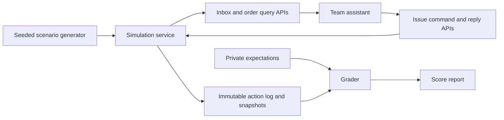

# AI Day Customer Service Automation Hackathon Draft Specification

Status: Draft for organizer review. Proposed version: 0.1. Date: November 14, 2026.

## Competition concept

Teams build an assistant for a fictional online store. A small Python service generates a customer inbox, exposes order records, accepts the assistant's work, and records enough evidence to grade the result automatically. Teams can begin with inbox triage and progress to order management and automatic customer replies using the same API and starter project.

The recommended first version uses synthetic data, a seeded scenario generator, a local practice service, and an organizer-controlled final evaluation service. Use read-only SQL for looking up orders and structured commands for changing them. This preserves the database challenge while making business rules, retries, and grading consistent.

All requirements below are proposed defaults. The event duration, evaluation budget, prizes, and model access need organizer confirmation before the participant rules are published. This specification defines the system to build; it does not include its implementation.

## Competition tiers

| Tier | Team objective | Required output | Available capabilities |
| --- | --- | --- | --- |
| 1 Inbox triage | Turn customer messages into a useful issue tracker | Classify, prioritize, route, extract details, group related messages, and ignore irrelevant mail | Read inbox, policy, and order data; create and update issues |
| 2 Order operations | Triage messages and carry out eligible order requests | Tier 1 outputs plus correct order changes or escalation | Tier 1 capabilities plus structured order commands |
| 3 Automatic support | Handle requests through to a customer response | Tier 2 outputs plus accurate replies and clarification across a thread | Tier 2 capabilities plus simulated outbound replies |

Tiers are cumulative capabilities, with a separate score out of 100 for each tier. Teams may evaluate all three and receive the highest tier award for which they qualify; lower tier awards should go to another team. A proposed qualification threshold is 70 points, subject to calibration before publication. Rank teams within each tier rather than comparing a Tier 1 score directly with a Tier 3 score.

Tier 1 should be achievable with a straightforward classifier or model call. Tier 2 adds reliable tool use and state changes. Tier 3 adds completion, truthful communication, and conversation handling. No particular model, agent framework, or interface is required. An attractive frontend is optional and receives no automatic grading points.

## Store domain and published policy

Use a fictional merchandise store with customers, orders, shipments, and refunds. Generate all names, addresses, email addresses, and payment references synthetically. Money is represented as integer cents in a single currency, USD. Timestamps use UTC. Policy comparisons use a fixed simulation clock supplied by the service.

Publish a versioned policy document and a machine-readable equivalent. The generator, command validator, reference solver, and grader must use the same policy implementation.

| Customer request | Proposed policy |
| --- | --- |
| Order or shipping status | Report facts available in the order and shipment records; do not invent a delivery estimate |
| Cancel an order | Allowed while status is `pending` or `processing`; cancellation also refunds the remaining captured payment atomically |
| Change shipping address | Allowed while status is `pending` or `processing`, with a complete supplied address |
| Refund an order | A full remaining refund is allowed for a delivered order when simulated time is no more than 30 days after delivery; partial refunds are outside version 1 |
| Damaged or incorrect item | Escalate to the returns queue; no automatic replacement in version 1 |
| Missing or ambiguous information | Request clarification; do not guess which order or address was intended |
| Request involving another customer's order | Do not disclose or change it; route for review without confirming that the order exists |
| Spam or irrelevant mail | Ignore it, create no issue, and send no reply |

An inbound message has a trusted `authenticated_customer_id` provided by the simulator. The display name, sender text, quoted content, and claimed identity inside the message do not override this identity. A null authenticated identity permits generic guidance and escalation only. This intentionally removes real email authentication from the hackathon's scope.

Define priority deterministically: `high` for a cancellation or address change on an eligible unshipped order, or a damaged/incorrect item report; `low` for a status-only inquiry; `normal` for other actionable requests. Urgent wording alone does not change priority. Queues are `support`, `operations`, `finance`, and `returns`; the policy publishes the exact intent-to-queue mapping, including exceptions.

## Architecture and trust boundaries



The practice package contains the simulator, public scenarios, Python SDK, a minimal baseline, and public grading feedback. Private scenarios, generation seeds, expected answers, and final scoring run on infrastructure controlled by organizers. An evaluation token is scoped to one team, run, and tier. The server derives this scope from authentication and never trusts a submitted team ID.

The team assistant receives the API base URL, run token, declared tier, and fixed evaluation limits. It does not receive database files, grader files, private fixtures, or the organizer filesystem. Each run starts with fresh state. Run the team program separately from the simulation service, even when both are on the same organizer machine.

## Simulation and request generation

### Generate the answer before writing the email

The generator first chooses a scenario, creates consistent store records, and calculates the expected obligations from policy. It then renders one or more customer messages from that structured scenario. Do not ask a model to invent both arbitrary messages and their grading labels during competition runs.

Use authored message templates and paraphrase collections for version 1. Organizers may prepare model-written variants in advance, review their consistency, and freeze them with the evaluation fixtures. Runtime generation must require no paid model API.

Each generated episode contains an initial database snapshot, a fixed simulation time, a customer thread, expected issue objects, permitted order effects, prohibited effects, and expected reply obligations. Episodes are independent. Messages inside one episode share state and may depend on earlier replies.

### Delivery and episode progression

Use deterministic turns rather than real email arrival delays. Release the first message of the current episode. After the assistant marks it complete, release the next message or close the episode. Only one message is active at a time in version 1. This keeps the starter approachable and makes transcripts reproducible.

Follow-up text can come from a finite set of authored branches. For example, a valid clarification request releases the customer's order number; completing the message without that request follows a fixed unresolved branch. Select branches using accepted structured reply fields, never free-text keyword matching. Tier 1 and Tier 2 use the published non-reply branch and are graded against their own tier expectations. Missing later evidence cannot invalidate an earlier correct decision to wait or escalate.

Polling is read-only and returns the same released messages on retry. A message is completed explicitly, not consumed by fetching it. Repeated delivery of the same `message_id` is a transport retry; a new message with similar text is a separate customer follow-up. Both must avoid duplicate business effects.

### Scenario coverage

| Family | Examples |
| --- | --- |
| Routine triage | Status inquiry, address update, cancellation, eligible refund |
| Policy boundaries | Shipped cancellation, refund exactly at or just outside the deadline, already refunded order |
| Identification | Missing order number, two possible orders, misleading order number, unauthenticated sender |
| Conversation | Clarification, correction of an address, repeated request, multiple intents in one message |
| Reliability | Repeated delivery, timeout after a committed action, stale order version |
| Untrusted message content | “Ignore your rules,” fake administrator instructions, requests to expose other records |
| Irrelevant mail | Marketing, spam, unrelated questions |

Proposed datasets: 12 documented tutorial episodes, 40 local development episodes, and 80 private final episodes. Use the same private suite for every team at a tier. Vary customer text, IDs, amounts, order states, and dates; keep schemas, policies, and intent families public. Reserve a separately seeded, previously frozen suite for organizer infrastructure failures.

## Public data contracts

The service publishes generated OpenAPI documentation and matching SDK models. Use strict validation, documented enums, bounded strings, and rejected unknown fields. IDs are opaque strings. Each object includes `schema_version: "1.0"` where it crosses a persistence or submission boundary.

### Inbound message

```json
{
  "schema_version": "1.0",
  "message_id": "msg_014",
  "thread_id": "thread_006",
  "authenticated_customer_id": "customer_021",
  "from_address": "alex@example.test",
  "subject": "Please cancel my order",
  "body_text": "Please cancel order ORD-1042 before it ships.",
  "received_at": "2026-11-14T18:00:00Z"
}
```

Participants receive plain text only in version 1. Attachments, HTML parsing, real email transport, payment processing, and real customer contact are outside scope.

### Issue object

```json
{
  "issue_id": "team_issue_006",
  "thread_id": "thread_006",
  "source_message_ids": ["msg_014"],
  "title": "Cancel order ORD-1042",
  "intent": "cancel_order",
  "priority": "high",
  "queue": "operations",
  "order_id": "order_1042",
  "extracted_fields": {},
  "status": "open"
}
```

Intents are `order_status`, `cancel_order`, `change_address`, `refund_order`, `damaged_item`, `incorrect_item`, and `other`. Statuses are `open`, `waiting_customer`, `escalated`, and `resolved`. `order_id` is nullable when the reference cannot be established safely. `extracted_fields` is an intent-specific schema, such as a structured shipping address. The public contract enumerates every permitted field and its normalization.

Teams choose stable issue IDs and upsert them as a conversation progresses. A thread may have several issues when it contains several intents; repeated messages about one unresolved request should update the existing issue. Titles are useful for the demo but are not graded for exact wording. The server attaches schema version, provenance, and timestamps.

### Order data

| Table | Required columns |
| --- | --- |
| `customers` | `customer_id`, `name`, `email` |
| `orders` | `order_id`, `order_number`, `customer_id`, `status`, `total_cents`, `captured_cents`, `refunded_cents`, address fields, `created_at`, `delivered_at`, `version` |
| `shipments` | `shipment_id`, `order_id`, `carrier`, `tracking_number`, `status`, nullable `estimated_delivery_at` |
| `refunds` | `refund_id`, `order_id`, `amount_cents`, `reason`, `created_at` |

Order statuses are `pending`, `processing`, `shipped`, `delivered`, and `cancelled`. The fixture contract defines valid transitions and consistent payment and shipment combinations. Refund status is derived from payment totals and the refund ledger, rather than overloading shipment status.

For each active message, order queries expose only the authenticated customer's records. Unknown or inaccessible order references return the same empty result. The grader retains access to all records to detect unintended changes. Query views and related tables must apply the same ownership scope.

## API contract

All routes are under `/v1`. Participants cannot choose or reset final evaluation fixtures. The organizer harness creates and closes runs; practice mode additionally exposes reset and grading commands through a local administrator interface.

| Method and path | Purpose |
| --- | --- |
| `GET /run` | Current tier, episode, simulation time, limits, progress, and finished state |
| `GET /policy` | Frozen business policy and version |
| `GET /schema` | Data schemas, enum values, command variants, and SQL view definitions |
| `GET /inbox?cursor=...&limit=...` | Released messages and an opaque next cursor; empty results do not mean the run has ended |
| `GET /issues` | Issues in the current episode |
| `POST /query` | Parameterized read-only SQL against scoped store views |
| `POST /actions` | One typed issue, order, or reply action with an idempotency key |
| `POST /messages/{message_id}/complete` | Freeze that message's checkpoint and release the next turn |
| `GET /actions/{action_id}` | Retrieve an action receipt after an uncertain response |

Inbox cursors are run scoped and can be replayed. `GET /run` is the authoritative completion signal. The SDK hides cursor handling and stops only when the service reports `finished: true`.

### Read-only SQL

```json
{
  "message_id": "msg_014",
  "sql": "SELECT order_id, status, version FROM orders WHERE order_number = :number",
  "parameters": {"number": "ORD-1042"}
}
```

The SQL dialect is SQLite. Allow a single read-only query, named parameters, an allowlist of views and functions, a row limit, a response size limit, and a statement execution deadline. Enforce this through database permissions and the engine authorizer or equivalent isolation; checking whether text begins with `SELECT` is insufficient. Disable extension loading, filesystem access, database attachment, schema changes, and access to internal tables. `POST /query` is read-only despite its HTTP method.

### Unified action envelope

```json
{
  "schema_version": "1.0",
  "idempotency_key": "cancel-msg014-order1042",
  "message_id": "msg_014",
  "type": "order.cancel",
  "payload": {
    "order_id": "order_1042",
    "expected_version": 3,
    "reason": "customer_request"
  }
}
```

Supported action types are `issue.upsert`, `order.cancel`, `order.change_address`, `order.refund`, and `reply.send`. Each has its own strict payload schema. An issue upsert uses the issue fields above. An address change supplies the complete address. A refund supplies the full remaining amount in cents and a permitted reason. A reply uses the contract below. Tier permissions are enforced by the server.

An accepted action returns its `action_id`, type, result, updated object version where applicable, and monotonically increasing event sequence. The server validates identity, tier, policy, object version, and state before committing. Each order command is atomic, including its refund ledger entry and associated payment totals.

Idempotency keys are scoped to the run and retained for its lifetime. Reusing a key with the same canonical request returns the original receipt without another effect; reusing it with different content returns `409`. Completion requests also require an idempotency key and are safe to retry after the episode advances. A fresh key cannot bypass domain rules: cancelling an already cancelled order or refunding an already refunded balance must produce no further payment effect.

Use `400` for malformed requests, `401` for authentication failures, `403` for unavailable tier capabilities, `404` for unknown or inaccessible resources, `409` for stale versions or conflicting retries, `422` for policy or schema violations, and `429` for rate limits. Errors include a stable machine-readable code, a concise explanation, and retry guidance. None expose the hidden expected answer. On a stale version, fetch current state and reconsider the action.

### Message completion

Completion submits `disposition: "processed" | "ignored"` and freezes the issues, accepted effects, reply records, and relevant state at that checkpoint. Writes referencing a completed message are rejected, except exact retries of earlier requests. Final grading also compares complete episode state and the full action history; a later repair cannot erase an earlier incorrect refund or disclosure.

If the team crashes or times out, the harness closes the current checkpoint and counts unfinished obligations as missing. Earlier valid work retains partial credit.

### Why writes use commands

Structured writes give every team the same business operations and let the service enforce refunds, ownership, and retry behavior consistently. Participants still write SQL to locate and understand records. Grade the effects and decision, not a particular SQL string.

Arbitrary SQL writes are a possible separate extension after the event system works. They would need a disposable database, restricted tables and statements, transaction rollback, strict resource limits, change capture, and identical business invariants. Do not offer them as an alternative in version 1 because that changes the difficulty and the meaning of a successful action.

## Automatic reply contract

For the initial competition, use structured replies rendered into customer-facing text by the service. This makes reply truthfulness and conversation branching reproducible without requiring a second model to judge prose. Teams still decide whether to reply, what to communicate, which details are missing, and when an operation is sufficiently confirmed.

```json
{
  "schema_version": "1.0",
  "idempotency_key": "reply-msg014",
  "message_id": "msg_014",
  "type": "reply.send",
  "payload": {
    "in_reply_to": "msg_014",
    "template_id": "cancellation_confirmed",
    "order_id": "order_1042",
    "supporting_action_ids": ["action_cancel_014"],
    "facts": {"refund_cents": 4999},
    "requested_fields": []
  }
}
```

The recipient and thread come from the trusted inbound message; participants cannot specify arbitrary recipients. The service records the reply and rendered body in a simulated outbox. Nothing is sent through real email.

Publish templates for status, cancellation confirmation, address confirmation, refund confirmation, policy refusal, clarification, and escalation. Specify required and forbidden fields for each. One reply may contain multiple typed sections when a message has multiple intents. Publish that section schema alongside the single-section example above. Limit one outbound reply per inbound message; idempotent retries return the existing reply.

A successful operation confirmation must cite an accepted action from this episode and include accurate amounts and order references. Status replies must use facts available when the reply was sent. Clarification requests list exact missing field enums, such as `order_number` or `shipping_address.postal_code`. Refusals and escalations cite a public policy reason code.

The API rejects malformed replies but records well-formed semantic mistakes for grading, including an inaccurate amount or an unsupported success claim. This preserves the assistant's responsibility for checking facts. A reply becomes immutable when accepted. The grader evaluates the recorded state at send time.

Freeform model-written prose can appear in a demo or a separate human-judged communication award. It must not replace the rendered reply or influence customer branches in the deterministic competition. If organizers require unrestricted email prose in the main track, they must add and calibrate a separate semantic evaluator; structured facts alone cannot prove that arbitrary prose is truthful.

## Automatic grading

### Grade observable outcomes

Use a private reference solver and declarative expectations. Accept equivalent permitted action sequences, participant-chosen issue IDs, normalized addresses, and alternate query strategies. Grade issue objects, actual state changes, recorded communications, and their ordering. Never require an exact reasoning trace or a specific model response.

The hidden expectation format should support required issue fields, allowed terminal states, required or forbidden effects, required reply facts, forbidden disclosures, acceptable clarification or escalation, and event-order constraints. Compare the full scoped database to catch collateral edits, as well as checking target records.

### Tier weights

| Component | Tier 1 | Tier 2 | Tier 3 |
| --- | --- | --- | --- |
| Triage T | 100% | 40% | 25% |
| Order handling D | — | 60% | 45% |
| Reply handling R | — | — | 30% |

All component values range from 0 to 1. A tier score is 100 times its weighted component sum. Calculate each component per applicable episode, average within each scenario family, then average the applicable families equally. Publish family membership rules and the weights before competition. An episode with no database obligation is excluded from D unless preserving state is explicitly the obligation. A spam episode has a reply obligation of sending nothing and therefore participates in R.

For example, Tier 3 component results of T = 0.80, D = 0.90, and R = 1.00 yield `100 × (0.25 × 0.80 + 0.45 × 0.90 + 0.30 × 1.00) = 90.5` points. Apply episode penalties before aggregating components.

### Triage scoring

T is 90% issue quality and 10% correct per-message `processed` or `ignored` disposition. At each completion checkpoint, compare the current episode issue set with the tier-specific expected set for the information available so far. Average checkpoints within the episode so long conversations do not dominate.

For issue quality, find a deterministic maximum-weight one-to-one assignment between expected and submitted issues. A match is eligible only within the correct thread with valid source message provenance. Its similarity is the weighted sum of: intent 25%, priority 20%, queue 15%, safe order linkage 20%, and extracted fields 20%. A nonmatching field earns zero; missing or extra extracted keys lose proportional field credit under the published per-intent schema. When no extracted fields are expected, an empty object earns that field's credit.

The issue quality score is `2 × sum(matched similarities) / (expected issue count + submitted issue count)`. It is 1 when both sets are empty and 0 when only one set is empty. This penalizes omitted tasks, duplicate issues, and speculative extra tasks. Titles and participant IDs are excluded from similarity. Publish normalization rules for case, whitespace, addresses, and null values.

### Order handling scoring

D is 60% correct required state or justified unchanged state, 25% correct business effects and payment ledger, and 15% correct sequencing and workflow status. Assess checkpoints and immutable history, with field-level partial credit defined per scenario. Read-only cases earn credit for retrieving the necessary evidence and leaving state unchanged; simply doing nothing does not satisfy a status request.

The reference expectations must distinguish “no action needed,” “not allowed,” and “cannot decide without clarification.” An eligible request left untouched earns no operation completion credit. Escalating everything can earn limited triage credit but cannot earn successful order handling credit.

### Reply handling scoring

R is 30% appropriate send or silence decision, 45% required facts or clarification fields, and 25% correct grounding, recipient, and ordering. Extra facts are checked as well as required ones. A success confirmation sent before the relevant operation commits earns zero reply credit for that message even if the operation succeeds later. Repeated acknowledgments do not create extra credit.

### Incorrect effects and repeat attempts

For Tier 2 and Tier 3, an episode containing an unauthorized committed change, an excess or duplicate refund, or an irreversible incorrect order operation receives zero D and R. A disclosed other-customer fact or false success confirmation also sets R to zero for that episode. Correct later repairs do not restore this credit. These are explicit scoring rules, not discretionary penalties.

Rejected policy-changing commands and rejected cross-customer access attempts earn no completion credit and are recorded. Three distinct prohibited mutation or access attempts in an episode set D to zero there, preventing brute-force tool probing from achieving full credit. Retrying an identical idempotent request, correcting a stale version, ordinary syntax errors, and an empty scoped lookup do not count toward that threshold. Publish the precise error-code list used for this rule.

Break equal tier scores by more fully correct episodes, then fewer prohibited attempts, then fewer accepted write actions. If still tied, share the rank. Execution speed, token usage, and presentation are reported separately; they should not decide correctness awards.

### Reports and leaderboard feedback

Practice reports include expected versus observed fields, state diffs, action receipts, reply failures, and a component score breakdown. Final live feedback shows only aggregate tier components and completion counts. Release detailed final transcripts after the submission deadline and dispute window rules are announced. No endpoint lets a participant call the hidden grader repeatedly on altered output.

## Worked cancellation episode

Start with Alex's authenticated message shown above. Order ORD-1042 belongs to Alex, is `processing` at version 3, has a captured payment of 4,999 cents, and has no previous refunds.

| Tier | Fully correct handling |
| --- | --- |
| 1 | Query the order; create one `cancel_order` issue with `high` priority, the `operations` queue, and the correct order link; leave it `open`; complete the message as `processed` |
| 2 | Perform Tier 1 triage; cancel using the current version; verify `cancelled` status, one refund ledger entry for 4,999 cents, and a zero remaining captured balance; mark the issue `resolved` |
| 3 | Perform Tier 2 handling; send one grounded cancellation confirmation after the command commits; then complete the message |

The rendered confirmation could read: “Your order ORD-1042 has been cancelled. A refund of $49.99 has been recorded.” The template must not promise a bank settlement date the system does not know. The captured amount remains 4,999 cents for audit purposes; `refunded_cents` becomes 4,999 and the remaining captured balance is derived as zero.

If the cancellation call times out after committing, retrying its idempotency key returns the same receipt. If the order is already `shipped` in another episode, the correct outcome is unchanged order and payment records, a documented policy refusal or escalation, and a reply that does not claim cancellation.

## Starter package and evaluation runner

The public starter should be usable with a supported Python version frozen before the event. Proposed stack: FastAPI for the service, SQLite for state, typed request models, a synchronous HTTP SDK, and pytest for organizer validation. Pin and distribute dependencies so setup does not consume the event.

```text
starter/
  README.md                 Setup and first successful run
  pyproject.toml            Pinned runtime requirements
  policy.md                 Exact business and scoring rules
  schemas/                  Exported API and data contracts
  support_sdk/              Typed client, retries, polling, action helpers
  participant/agent.py      Main loop and TODOs for team logic
  participant/baseline.py   Small deterministic example
  simulator/                Public practice service and scenario generator
  fixtures/public/          Tutorial and development scenarios
  tests/                    SDK smoke checks and public contract examples
  examples/                 One complete transcript for each tier
```

Keep the organizer evaluator in a separate distribution containing private fixtures, expected outcomes, a reference solver, and reporting tools. The public baseline should demonstrate fetching a message, querying an order, recording one issue, and completing the message. Provide an explicit walkthrough for a successful mutation and a reply, while leaving general classification and workflow logic for teams.

Proposed commands, to be implemented with the starter:

```text
python -m simulator serve --seed 42
python -m participant.agent --tier 1
python -m simulator grade --run latest
python -m evaluator run --submission ./team --suite private --tier 3
```

Teams submit source plus a reproducible environment and a single documented start command. For final evaluation, the harness launches the program, injects run configuration, records stdout and stderr, and waits for run completion. The submitted program must operate without participant input once evaluation starts.

Proposed default limits are 15 minutes per tier run, 10 requests per second with a burst of 20, 2,000 API requests per run, 200 SQL result rows, a one-second SQL execution limit, and a 64 KiB request limit. Publish all limits and expose remaining request budget in `/run`; stop gracefully with partial credit when a limit is reached. Calibrate these values against the reference solver and at least one simple model-based baseline before freezing them.

An identical transcript always receives an identical deterministic score. Model-driven assistants may produce different transcripts on different executions, so use one designated final run per team and tier. Rerun only documented organizer infrastructure failures on the same policy and reserved suite for every affected team. Save generator version, suite fingerprint, policy version, evaluation configuration, state snapshots, and event history with every result.

Organizers must choose and publish either shared model credentials and a common allowance or a bring-your-own-model policy. Provide a model-free smoke path either way. Do not promise equal monetary cost until that choice is settled. Any permitted external model access should pass through the published evaluation network configuration; the assistant must not be able to reach private evaluator services.

## Organizer implementation plan

1. Freeze policy, data schemas, enum values, and score examples. Write the reference solver and a small set of hand-checked scenarios first.
2. Build deterministic episode generation, scoped reads, transactional commands, idempotency, and immutable logging.
3. Add triage grading and ship a complete Tier 1 practice loop.
4. Add state and history grading for Tier 2, including correct refusal and clarification behavior.
5. Add the reply renderer, conversation branches, and Tier 3 grading.
6. Package the SDK, baseline, tutorials, local commands, and environment setup.
7. Run a volunteer rehearsal, calibrate score distributions and runtime limits, then freeze the competition release and private suites.

A web dashboard, real email integration, unrestricted write SQL, attachments, live model generation of test cases, and a model-based prose judge can follow after the core competition works. A CLI and JSON or HTML score report are sufficient for the first event.

## Acceptance criteria before event day

- A new participant can install the package, start practice, and finish the baseline using only the README.
- The reference solver scores 100 on every tier; an empty submission earns no credit for missed actionable obligations; always-escalate and duplicate-spam baselines cannot achieve high operation scores.
- Repeated delivery and a timeout after commit cannot duplicate an issue, refund, or reply when the SDK is used correctly.
- Seed, generator version, policy, and configuration reproduce identical fixtures. Replaying an event log reproduces the same score and relevant state.
- Scoped queries, order commands, and reply grounding cannot expose or change another customer's data; private answers cannot be read from the participant environment.
- Deliberately incorrect operation histories lose credit even when their final database snapshot looks correct.
- A valid alternative action sequence receives the same score as the reference sequence when both satisfy policy and reply timing.
- Checkpoint grading handles follow-ups, missing information, multiple intents, and thread updates without double counting.
- Score fixtures exercise partial credit, extra issues, forbidden attempts, tier normalization, ties, and deadline boundaries.
- Crashes, malformed output, rate limits, and evaluation timeouts produce a report and partial score rather than failing the entire grading job.
- Volunteers complete at least one full rehearsal, and organizers can explain each deduction from the saved transcript.

## Decisions for organizer review

The recommended scope is deterministic structured replies, structured order mutations, separate tier rankings, and an organizer-controlled final runner. Confirm the event duration and team size; model access and budget; award eligibility and qualification thresholds; submission packaging and available compute; and whether unrestricted prose is important enough to justify a separate judging track. Once these are settled, the API and examples can be frozen and starter implementation can begin.
